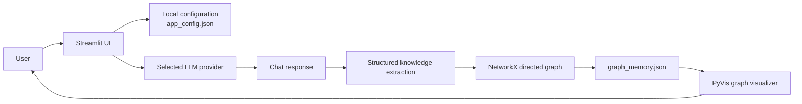

# Architecture

CortexKG is a local-first Streamlit application. A user selects an LLM provider, exchanges chat messages, extracts structured entities and relationships, and persists the resulting graph as JSON on the local filesystem.

## Components

| Component | Responsibility |
| --- | --- |
| `app/app.py` | Streamlit UI, session state, chat lifecycle, import/export controls. |
| `app/config_manager.py` | Thread-safe local provider and UI preference persistence. |
| `app/llm_service.py` | Provider creation, prompt formatting, response streaming, structured extraction. |
| `app/graph_service.py` | NetworkX graph initialization and idempotent node/edge updates. |
| `app/storage_service.py` | JSON persistence and restoration of the graph. |
| `app/ui_components.py` | PyVis graph rendering and footer. |

## Data handling

- The graph and application settings are local files and are ignored by Git.
- Provider keys are entered through the Settings panel; they must not be committed or exported in support logs.
- Imported graph JSON is trusted user input and is rendered as data, not executed code.
- `CORTEXKG_CONFIG_FILE` may redirect the local configuration file to an absolute path for deployments that need durable storage.

## Reliability targets

CortexKG is intended for personal, local knowledge management. It has no multi-tenant server or uptime guarantee. For production hosting, target successful graph save/load for 99% of healthy requests and track provider-call failures separately from local UI failures.
